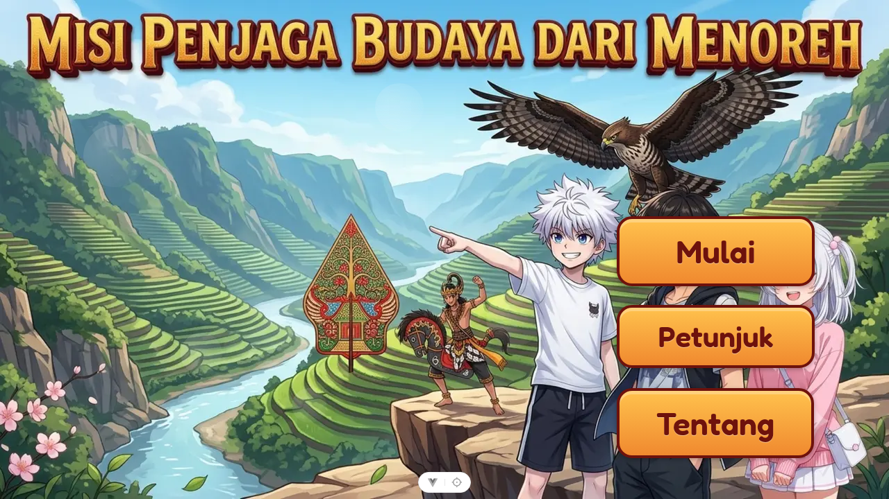
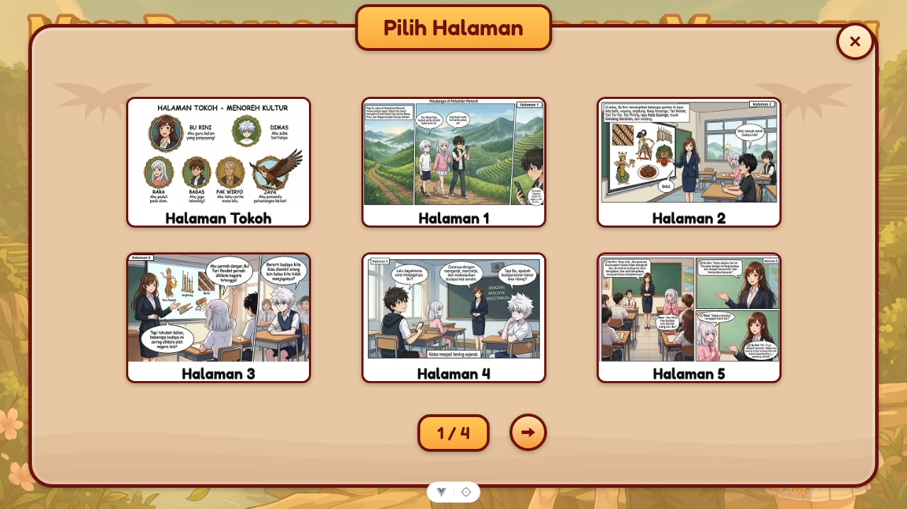
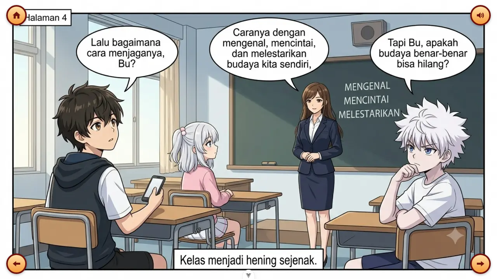
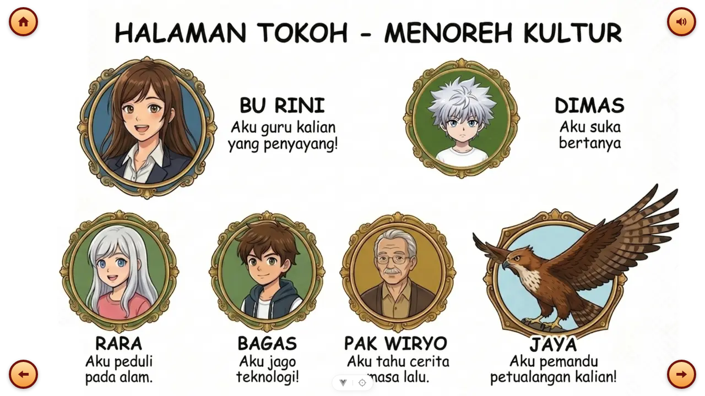
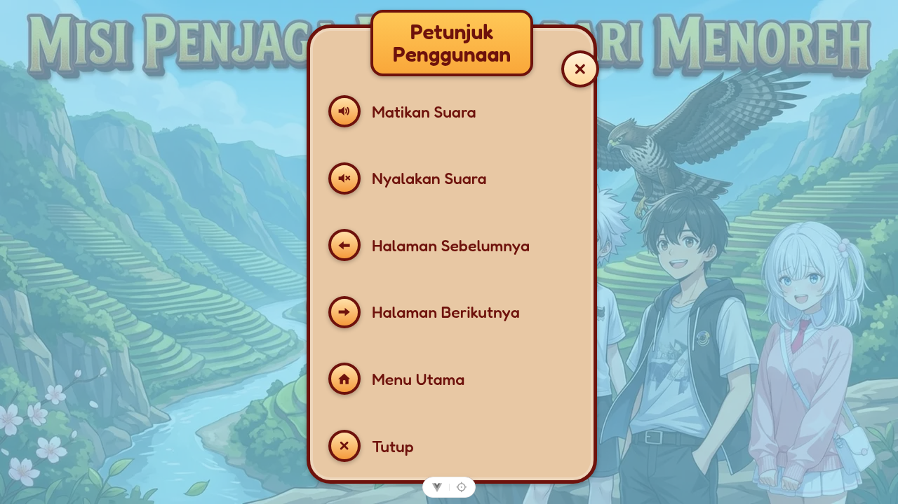
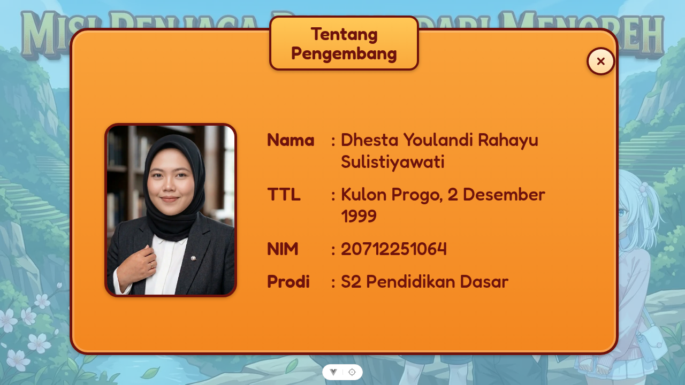
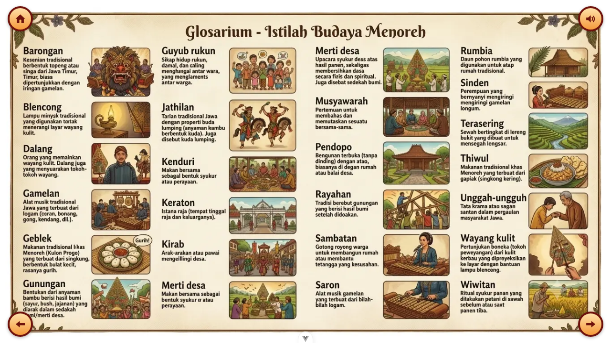
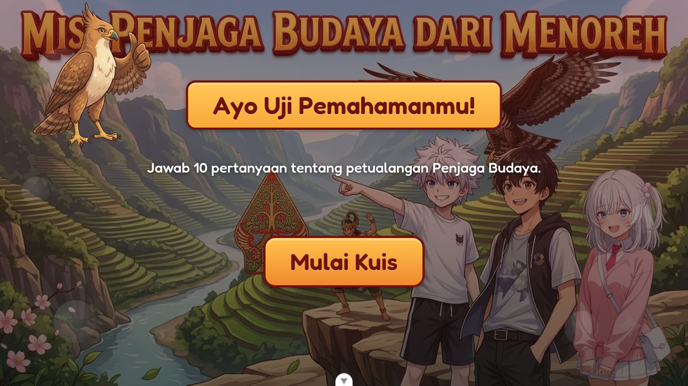
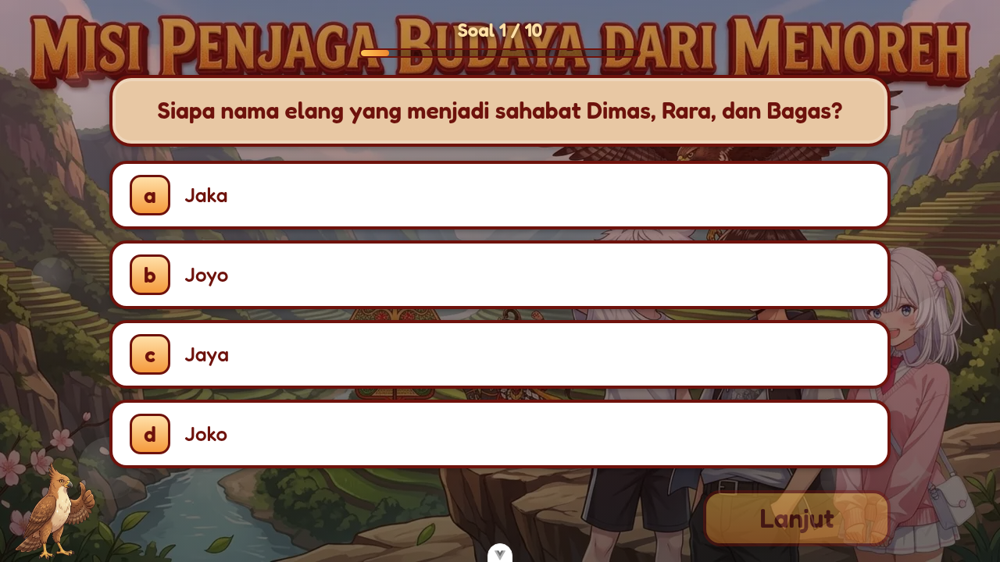
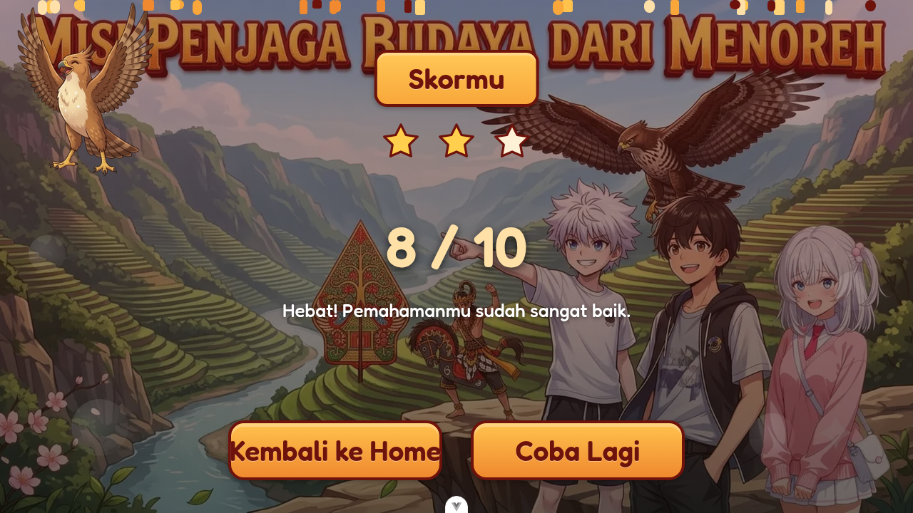

# Panduan Penggunaan — Misi Penjaga Budaya dari Menoreh

Panduan ini menjelaskan cara **memasang** dan **memakai** aplikasi **Misi Penjaga Budaya dari Menoreh** dari awal sampai selesai. Ditujukan untuk guru, orang tua, dan siswa.

## Tentang Aplikasi

**Misi Penjaga Budaya dari Menoreh** adalah aplikasi cerita bergambar untuk siswa sekolah dasar. Aplikasi ini mengisahkan petualangan Dimas, Rara, dan Bagas bersama elang Jaya dalam menjaga warisan budaya dan kearifan lokal kawasan Menoreh, Kulon Progo.

Isinya:

- **24 halaman** — halaman perkenalan tokoh, 22 halaman cerita bergambar, dan satu halaman Glosarium istilah budaya.
- **Musik latar** yang berganti mengikuti suasana tiap halaman.
- **Kuis 10 soal** di akhir cerita untuk menguji pemahaman.

Aplikasi ini **tidak memerlukan akun, tidak memuat iklan, dan tidak mengumpulkan data apa pun**.

## Prasyarat

| Kebutuhan | Keterangan |
|---|---|
| **Sistem operasi** | **Android 6.0 (Marshmallow) atau lebih baru** |
| **Ukuran berkas** | ± 31 MB (satu berkas APK untuk semua jenis HP) |
| **Internet** | **Tidak diperlukan.** Semua gambar, musik, dan huruf sudah ada di dalam aplikasi |
| **Posisi layar** | **Mendatar (landscape)** — otomatis, tidak perlu diatur |
| **Akun** | Tidak perlu mendaftar atau masuk |
| **Izin aplikasi** | Tidak ada izin yang perlu Anda setujui saat memakai aplikasi |

> **Catatan tampilan:** aplikasi dirancang pada layar berukuran 16:9. Pada HP masa kini yang layarnya lebih panjang, akan muncul **bidang putih di sisi kiri dan kanan**. Itu normal, bukan kerusakan — gambar sengaja dijaga agar tidak melar.

---

## Bagian 1 — Memasang Aplikasi

Aplikasi ini **tidak tersedia di Google Play Store**, jadi pemasangannya dilakukan secara manual dari berkas APK. Langkah-langkah di bawah dilakukan sekali saja.

> Langkah pada bagian ini melibatkan dialog bawaan Android yang berbeda-beda tampilannya antar merek HP (Samsung, Xiaomi, Oppo, dan seterusnya), sehingga tidak disertai gambar. Nama tombolnya bisa sedikit berbeda, tetapi urutannya sama.

### 1.1 Siapkan berkas APK yang benar

Gunakan berkas:

```
Misi-Penjaga-Budaya-dari-Menoreh.apk
```

> ⚠️ **Jangan memakai berkas yang ada akhirannya**, seperti `-debug.apk` atau `-unsigned.apk`. Berkas itu hanya untuk keperluan pengembangan dan tidak untuk dibagikan. Berkas yang benar untuk dipasang **tidak memiliki akhiran apa pun** — namanya persis seperti di atas.

### 1.2 Pindahkan APK ke HP

Salin berkas APK ke HP dengan salah satu cara berikut:

- Sambungkan HP ke komputer memakai **kabel USB**, lalu salin berkasnya.
- Kirim lewat **WhatsApp**, **Telegram**, atau surel.
- Unggah ke **Google Drive**, lalu unduh dari HP.

### 1.3 Izinkan pemasangan dari sumber tidak dikenal

1. Buka berkas APK lewat aplikasi **Berkas** (*Files*) atau dari notifikasi unduhan.
2. Android akan menolak dan menampilkan pesan seperti **"Demi keamanan, ponsel Anda tidak diizinkan memasang aplikasi tidak dikenal dari sumber ini"**.
3. Ketuk **Setelan** pada pesan tersebut.
4. Aktifkan **"Izinkan dari sumber ini"** / **"Install unknown apps"**.
5. Tekan tombol **Kembali**, lalu ketuk **Pasang** (*Install*).

> Mulai **Android 8.0**, izin ini diberikan **per aplikasi** — jadi Anda mengizinkan aplikasi Berkas (atau WhatsApp) yang membuka APK-nya. Pada **Android 6 dan 7**, izin ini berupa satu sakelar umum di *Setelan → Keamanan → Sumber tidak dikenal*.

### 1.4 Lewati peringatan Play Protect

Setelah menekan **Pasang**, Google Play Protect kemungkinan menampilkan peringatan seperti **"Aplikasi tidak dikenal"** atau **"Unsafe app blocked"**.

Ketuk **Tetap pasang** (*Install anyway*) — bisa jadi tersembunyi di balik tautan **Detail selengkapnya**.

Peringatan ini muncul karena aplikasi ditandatangani sendiri oleh pengembangnya dan tidak melalui Play Store. Ini **wajar untuk semua aplikasi di luar Play Store** dan bukan tanda bahwa aplikasi berbahaya.

### 1.5 Selesai

Setelah pemasangan berhasil, ikon **Misi Penjaga Budaya dari Menoreh** muncul di layar aplikasi HP Anda. Ketuk untuk membuka. Aplikasi akan langsung berputar ke posisi mendatar.

### 1.6 Kalau gagal dengan pesan "App not installed"

Kemungkinan besar di HP itu **sudah pernah terpasang versi `debug`** dari aplikasi yang sama. Kedua versi memakai nama paket yang sama tetapi tanda tangan digital berbeda, sehingga Android menolak menimpanya.

**Solusi:** copot dulu aplikasi yang lama (*Setelan → Aplikasi → Misi Penjaga Budaya dari Menoreh → Copot pemasangan*), lalu pasang ulang.

### 1.7 Memperbarui ke versi lebih baru

Kalau nanti ada versi baru, **cukup pasang menimpa** yang lama — tidak perlu dicopot lebih dulu, selama sama-sama berkas `Misi-Penjaga-Budaya-dari-Menoreh.apk` (yang tanpa akhiran). Tidak ada data yang hilang, karena aplikasi ini memang tidak menyimpan data apa pun.

---

## Bagian 2 — Memakai Aplikasi

### 2.1 Halaman Utama

Saat aplikasi dibuka, muncul halaman utama dengan tiga tombol.



| Tombol | Fungsi |
|---|---|
| **Mulai** | Membuka pilihan halaman cerita |
| **Petunjuk** | Menampilkan arti tombol-tombol di aplikasi |
| **Tentang** | Menampilkan identitas pengembang |

> **🔊 Musik tidak langsung berbunyi?** Itu normal. Android sengaja menahan suara sampai layar disentuh pertama kali. **Sentuh layar satu kali** dan musik latar akan mulai berputar. Jadi bukan aplikasinya rusak.

### 2.2 Memilih Halaman

Ketuk tombol **Mulai** untuk membuka jendela **Pilih Halaman**.



- Tersedia **6 gambar kecil per layar**, terbagi menjadi **4 layar** untuk seluruh 24 halaman.
- Ketuk **panah kiri / kanan** di bawah untuk berpindah antar layar.
- Angka di tengah bawah (misalnya **1 / 4**) menunjukkan layar keberapa yang sedang dilihat.
- Ketuk gambar mana pun untuk langsung melompat ke halaman itu.

> Untuk menutup jendela ini, ketuk tombol **✕** di pojok kanan atas. Menyentuh area di luar jendela **tidak** menutupnya.

### 2.3 Membaca Cerita



Ada empat tombol di sudut-sudut layar:

| Tombol | Letak | Fungsi |
|---|---|---|
| 🏠 **Menu Utama** | Kiri atas | Kembali ke halaman utama |
| 🔊 **Suara** | Kanan atas | Menyalakan / mematikan musik (lihat [2.4](#24-mengatur-suara)) |
| ◀ **Halaman Sebelumnya** | Kiri bawah | Mundur satu halaman |
| ▶ **Halaman Berikutnya** | Kanan bawah | Maju satu halaman |

> **⚠️ Penting — tombol menghilang sendiri.** Setelah **3 detik** tanpa disentuh, keempat tombol memudar hilang supaya tidak menutupi gambar. **Sentuh layar sekali untuk memunculkannya kembali.** Sentuhan pertama itu hanya memunculkan tombol dan **belum menekan tombol apa pun** — jadi untuk berpindah halaman kadang perlu dua kali ketuk: sekali memunculkan, sekali menekan. Ini disengaja, bukan kerusakan.

**Susunan 24 halaman:**

| Halaman | Isi |
|---|---|
| **1** | Perkenalan tokoh |
| **2 – 23** | Cerita bergambar (22 halaman) |
| **24** | Glosarium — daftar istilah budaya Menoreh |



> **Kenapa nomor di gambar berbeda?** Karena halaman 1 dipakai untuk perkenalan tokoh, penomoran di dalam gambar cerita bergeser satu angka. Contohnya, halaman **5** menampilkan gambar bertuliskan *"Halaman 4"*. Nomor pada jendela **Pilih Halaman** mengikuti urutan aplikasi (1–24).

Menekan **◀ Halaman Sebelumnya** saat berada di **halaman 1** akan membawa Anda kembali ke **Menu Utama**.

### 2.4 Mengatur Suara

Tombol suara di **kanan atas** berganti rupa mengikuti keadaan musik:

| Ikon | Artinya | Kalau diketuk |
|---|---|---|
| 🔊 Pengeras suara **berombak** | Musik sedang berbunyi | Musik **dimatikan** |
| 🔇 Pengeras suara **bersilang** | Musik sedang senyap | Musik **dinyalakan** |

> **Setelan senyap tidak bertahan saat pindah halaman.** Setiap halaman punya musiknya sendiri, jadi berpindah halaman akan menyalakan musik kembali dari awal — walaupun sebelumnya Anda sudah mematikannya. Kalau ingin benar-benar hening, gunakan tombol volume HP.

### 2.5 Petunjuk

Ketuk tombol **Petunjuk** di halaman utama untuk melihat arti setiap tombol.



Isinya sama dengan tabel di bagian [2.3](#23-membaca-cerita) dan [2.4](#24-mengatur-suara) — berguna untuk siswa yang baru pertama kali memakai aplikasi.

### 2.6 Tentang Pengembang

Ketuk tombol **Tentang** untuk melihat identitas penyusun aplikasi.



| | |
|---|---|
| **Nama** | Dhesta Youlandi Rahayu Sulistiyawati |
| **TTL** | Kulon Progo, 2 Desember 1999 |
| **NIM** | 20712251064 |
| **Prodi** | S2 Pendidikan Dasar |

### 2.7 Mengerjakan Kuis

> **🔑 Cara masuk ke kuis — bagian yang paling sering terlewat.**
> **Tidak ada tombol kuis di halaman utama.** Satu-satunya jalan masuk adalah membaca sampai **halaman 24 (Glosarium)**, lalu menekan tombol **▶ Halaman Berikutnya**.



Setelah itu muncul halaman pembuka kuis.



Ketuk **Mulai Kuis** untuk memulai.



Cara mengerjakan:

1. Angka di atas (**Soal 1 / 10**) menunjukkan soal keberapa yang sedang dikerjakan.
2. Ketuk salah satu dari **empat pilihan jawaban** (a, b, c, d).
3. Jawaban yang dipilih akan ditandai warna oranye. **Jawaban masih boleh diganti** selama belum menekan Lanjut.
4. Ketuk **Lanjut** untuk ke soal berikutnya. Pada soal terakhir, tombolnya bertuliskan **Selesai**.

> **Tombol Lanjut terlihat redup?** Itu berarti belum ada jawaban yang dipilih. Tombolnya baru bisa ditekan **setelah** salah satu pilihan diketuk.

Beberapa hal yang perlu diketahui:

- **Tidak ada penilaian benar/salah per soal.** Ini disengaja agar siswa tidak berkecil hati di tengah jalan — semua hasil baru muncul di akhir.
- **Tidak ada tombol kembali** ke soal sebelumnya. Setelah menekan Lanjut, jawaban terkunci.
- **Tidak ada batas waktu.** Kerjakan dengan santai.

### 2.8 Skor dan Bintang

Setelah soal ke-10 dijawab, muncul halaman hasil.



Setiap jawaban benar bernilai **1 poin**, dari total **10 poin**. Jumlah bintang ditentukan dari skor akhir:

| Skor | Bintang | Pesan |
|---|---|---|
| **9 – 10** | ⭐⭐⭐ | *Luar biasa! Kamu Penjaga Budaya sejati!* |
| **7 – 8** | ⭐⭐ | *Hebat! Pemahamanmu sudah sangat baik.* |
| **4 – 6** | ⭐ | *Bagus! Ayo baca lagi ceritanya dan coba lagi.* |
| **0 – 3** | — | *Jangan menyerah! Yuk pelajari lagi kisah Menoreh.* |

Dua tombol di bawah:

- **Coba Lagi** — mengulang kuis dari soal 1.
- **Kembali ke Home** — kembali ke halaman utama.

---

## Tips & Pertanyaan Umum

**Musik tidak berbunyi saat aplikasi baru dibuka.**
Sentuh layar satu kali. Android menahan suara sampai ada sentuhan dari pengguna — ini aturan sistem, bukan kerusakan aplikasi.

**Tombol navigasi tiba-tiba hilang.**
Tombol memang memudar sendiri setelah 3 detik agar tidak menutupi gambar. Sentuh layar untuk memunculkannya lagi. Ingat, sentuhan pertama itu belum menekan tombol.

**Ada bidang putih di kiri dan kanan layar.**
Normal. Gambar dijaga pada perbandingan 16:9 supaya tidak melar. HP dengan layar panjang akan menyisakan ruang di kedua sisi.

**Apakah progres membaca dan skor kuis tersimpan?**
**Tidak.** Aplikasi ini sengaja tidak menyimpan apa pun. Menutup aplikasi berarti mulai lagi dari halaman utama, dan kuis diulang dari soal 1. Sisi baiknya: aplikasi **tidak menyimpan data pribadi siswa sama sekali** — aman dipakai di lingkungan sekolah.

**Bagaimana dengan tombol Kembali (Back) di HP?**
Tombol Back akan menyusuri halaman yang sudah dibuka. Menekan Back **saat sedang mengerjakan kuis akan keluar dari kuis dan jawaban hilang**. Menekan Back di halaman utama akan menutup aplikasi.

**Efek suara ketukan tombol tidak terdengar.**
Kalau di HP diaktifkan setelan *"Kurangi animasi"* / *"Remove animations"*, seluruh efek suara ketukan ikut dimatikan. Musik latar tetap berbunyi seperti biasa.

**Apakah butuh internet?**
Tidak. Seluruh cerita, musik, dan gambar tersimpan di dalam aplikasi. Bisa dipakai sepenuhnya dalam mode pesawat.

**Suara terlalu keras atau terlalu pelan.**
Gunakan tombol volume di sisi HP. Aplikasi mengikuti volume media perangkat.
